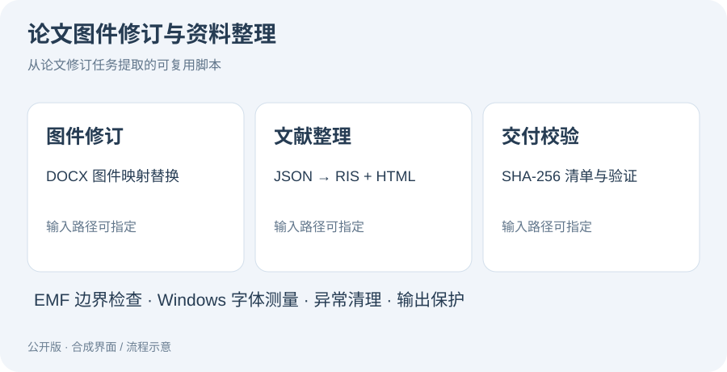

# 论文图件修订与资料整理自动化

**把论文修订中重复的图件替换、文献索引和交付文件校验写成可运行脚本。** 从个人论文修订任务整理，公开版使用合成样例。



Python · DOCX / ZIP · EMF / Windows GDI · RIS · SHA-256

## 快速运行

Python 3.10+；文档替换、文献整理和文件校验只用标准库。先生成独立样例：

```sh
python examples/make_demo.py
python paper_tools.py replace-images examples/generated/source.docx examples/generated/mapping.json outputs/revised.docx
python paper_tools.py bibliography examples/references.json outputs/references
python paper_tools.py manifest outputs outputs-manifest.json
python paper_tools.py verify outputs outputs-manifest.json
python native_emf_utils.py examples/generated/source.emf outputs/clean.emf
```

上述命令默认保护已有输出，不静默覆盖。示例生成器也不会覆盖已经存在的示例文件夹。

## 提供的工具

| 工具 | 作用 |
| --- | --- |
| `replace-images` | 根据 JSON 映射替换 DOCX 中指定的 `word/media/` 图件，保留其他 ZIP 部件的内容 |
| `bibliography` | 将文献元数据导出为 RIS 和可点击 HTML 索引，供文献管理器导入 |
| `manifest / verify` | 生成和核对 SHA-256 清单，报告缺失、改动与额外文件；验证失败退出码为 1 |
| `native_emf_utils.py` | 检查 EMF 记录边界、去除注释记录、测量字体和调整文本记录 |

DOCX 替换要求图件格式扩展名一致；不自动改正文、图注、版式和文献内容。文献元数据需要自行核对。EMF 文本测量需要 Windows GDI，解析与去除注释可跨平台运行；不支持 ETO_PDY 或字形索引文本记录。

## 实现与修复

- 移除具体论文、私人目录和原工作树的硬编码依赖，交付材料移动后仍能指定目录验证。
- 将 EMF 的 `assert` 校验改为显式异常；GDI 测量不会在 `python -O` 下被优化掉。
- 字体句柄和设备上下文在异常时也会释放；字符计数按 UTF-16 单元处理。
- 检查二进制记录长度与偏移，避免零长度记录死循环和越界读取。
- 路径校验拒绝目录穿越；DOCX 检查重复 ZIP 部件和解压大小上限。
- 文献索引转义 HTML、校验链接协议，RIS 字段去除换行注入。

## 检查

```sh
python -m unittest discover -s tests -v
python -O -m unittest discover -s tests -v
```

覆盖图件替换后的其他部件不变、输出保护、移动目录校验、篡改检测、路径安全、索引转义、坏 EMF 和 GDI 异常释放。已在 Windows 实际运行字体测量；不包含原论文或原生 Visio 导出验证。

## 项目来源

由个人论文图件修订与交接资料整理任务提取，使用 AI 辅助编码。原任务中针对某张图的具体布局改动和论文内容未公开；这里提供的是可复用代码与合成示例。

[作品集首页](https://github.com/WULUWA-233/computer-portfolio)
